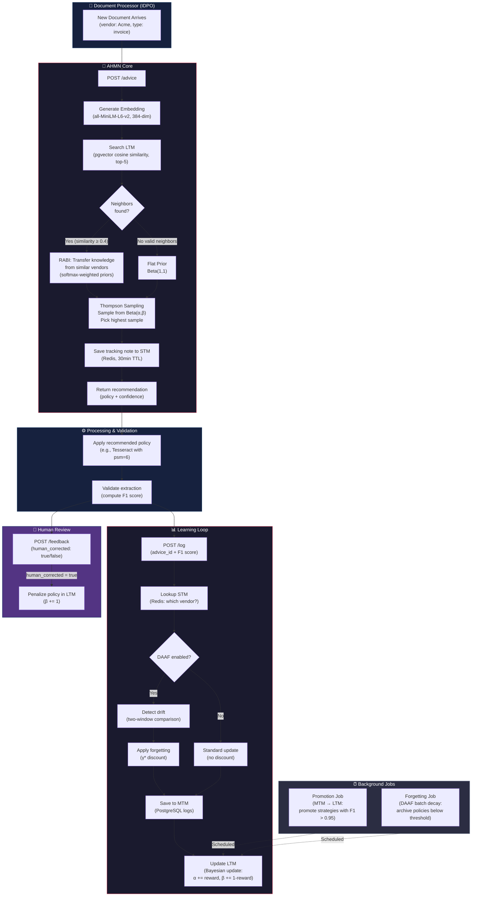
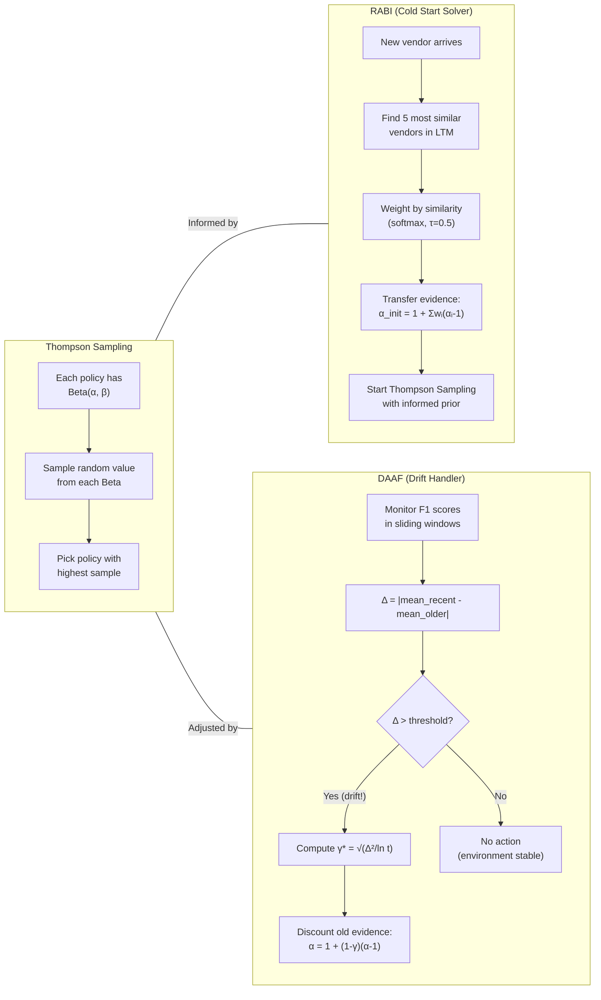
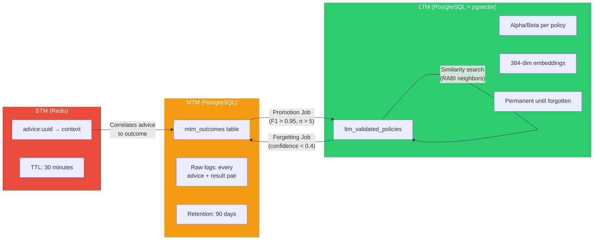

# AHMN: Adaptive Hierarchical Memory Network

> A self-learning document processing advisor that remembers what works, borrows knowledge from similar situations, and forgets strategies that stop working.

**Project**: Final Year Undergraduate Data Science Research  
**Stack**: FastAPI, PostgreSQL + pgvector, Redis, SentenceTransformers

---

## What Does AHMN Do?

Your document processing pipeline (IDPO) receives thousands of documents — invoices, receipts, contracts — from hundreds of different vendors. Each vendor's documents look different: different layouts, fonts, scan qualities. The question is: **which OCR engine and settings should we use for THIS specific document?**

AHMN is the **brain** that answers that question. It learns from every document it processes and gets smarter over time.

**Three Key Innovations:**

- **Thompson Sampling** — Bayesian explore-exploit policy selection
- **RABI** (Retrieval-Augmented Bandit Initialization) — Solves cold-start by transferring knowledge from similar vendors
- **DAAF** (Drift-Aware Adaptive Forgetting) — Adapts when document formats change

---

## Research Contributions

1. **DAAF Algorithm**: A drift-aware adaptive forgetting mechanism for contextual bandits that separates noise from genuine drift using two-window comparison, with a principled forgetting rate γ\* derived from the bias-variance tradeoff.
2. **RABI Integration**: Novel application of retrieval-augmented prior initialization for document processing bandits, using vector similarity to transfer knowledge from established vendors to cold-start contexts.
3. **Hierarchical Memory Architecture**: Three-tier memory system (STM/MTM/LTM) combining ephemeral session tracking, persistent logging, and Bayesian knowledge storage — optimized for real-time policy selection with long-term learning.
4. **Empirical Validation**: Rigorous evaluation across 4 scenarios (stationary, cold-start, drift, combined) with 7 baseline comparisons and ablation studies, demonstrating statistically significant improvements.

---

## System Architecture

```
┌─────────────────────────────────────────────────────────────────────┐
│                        AHMN CORE (FastAPI)                         │
│                                                                     │
│  ┌───────────┐    ┌───────────┐    ┌──────────────┐               │
│  │  /advice   │    │   /log    │    │  /feedback   │               │
│  │  (Step 1)  │    │ (Step 5)  │    │  (Step 6)    │               │
│  └─────┬─────┘    └─────┬─────┘    └──────┬───────┘               │
│        │                │                  │                        │
│        ▼                ▼                  ▼                        │
│  ┌──────────────────────────────────────────────────┐              │
│  │              MemoryService                        │              │
│  │  ┌──────────┐  ┌──────────┐  ┌────────────────┐ │              │
│  │  │ Thompson │  │   RABI   │  │     DAAF       │ │              │
│  │  │ Sampling │  │(Cold-Start│  │(Drift Detector)│ │              │
│  │  └──────────┘  └──────────┘  └────────────────┘ │              │
│  └──────────────────────────────────────────────────┘              │
│        │                │                  │                        │
│        ▼                ▼                  ▼                        │
│  ┌──────────┐   ┌────────────┐   ┌──────────────┐                │
│  │   STM    │   │    MTM     │   │     LTM      │                │
│  │  Redis   │   │ PostgreSQL │   │  PostgreSQL   │                │
│  │ (Cache)  │   │  (Logs)    │   │  (Knowledge)  │                │
│  └──────────┘   └────────────┘   └──────────────┘                │
└─────────────────────────────────────────────────────────────────────┘
```

---

## Quick Start

### Option A: Run Unit Tests (No Docker Needed)

```bash
cd ahmn_core
pip install -r requirements.txt
pytest tests/ -v
```

### Option B: Full System with Database

```bash
cd ahmn_core

# 1. Start PostgreSQL + Redis
docker-compose up -d

# 2. Install dependencies
pip install -r requirements.txt

# 3. Seed initial policies into LTM
python utils/seed_database.py

# 4. Start the API server
python main.py
# → Server runs at http://localhost:8000
```

### Option C: Run Unit Tests (Standalone)

```bash
cd ahmn_core
pytest tests/ -v
```

---

Think of AHMN's memory like how you remember things at work:

| Tier                        | What It Is                                                 | Storage                             | Lifespan                    | Real-World Analogy                                     |
| --------------------------- | ---------------------------------------------------------- | ----------------------------------- | --------------------------- | ------------------------------------------------------ |
| **STM** (Short-Term Memory) | A sticky note linking an advice session to its vendor      | Redis                               | 30 minutes                  | "I'm currently working on the ACME invoice"            |
| **MTM** (Mid-Term Memory)   | A logbook of every processing result                       | PostgreSQL `mtm_outcomes`           | 90 days                     | "Last Tuesday, Tesseract scored 0.92 on ACME invoices" |
| **LTM** (Long-Term Memory)  | The wisdom — validated policies with success/failure stats | PostgreSQL `ltm_validated_policies` | Permanent (until forgotten) | "For ACME invoices, Tesseract works 88% of the time"   |

**Key detail:** LTM stores each policy as a **Beta distribution** with two numbers — `alpha` (successes + 1) and `beta` (failures + 1). These are the "scorecards" that drive every decision. It also stores a 384-dimensional **vector embedding** of the vendor+doc_type context, enabling similarity search via `pgvector`invoices, Tesseract works 88% of the time" |

LTM stores each policy as a **Beta distribution** `Beta(α, β)` plus a **384-dim vector embedding** for similarity search via pgvector.

---The Full System Flow (6 Steps)

### Step 1 — The Request for Advice (`POST /advice`)

The document processor (IDPO) receives a new document. It doesn't know which OCR tool to use, so it sends the **vendor name** and **document type** to AHMN.

```json
{
  "doc_type": "invoice",
  "vendor": "acme_corp"
}
```

### Step 2 — The Smart Decision (Embedding + Similarity Search)

AHMN converts the context (`"invoice" + "acme_corp"`) into a **384-dimensional vector** using a sentence transformer model (`all-MiniLM-L6-v2`). It then searches LTM for the **top-5 most similar** policy records using cosine similarity (powered by pgvector).

**What happens next depends on whether RABI is enabled (it is by default):**

- **With RABI:** The system uses similarity-weighted knowledge transfer from neighbors to build an "informed prior," then runs Thompson Sampling with that enriched knowledge. This is especially powerful when the vendor is new or rare.
- **Without RABI:** Standard Thompson Sampling — sample from each policy's Beta(alpha, beta) distribution and pick the highest sample.

### Step 3 — The Hand-off and Tracking (STM / Redis)

AHMN sends its recommendation back to IDPO:

```json
{
  "advice_id": "a1b2c3...",
  "policy_id": "ocr_tesseract",
  "policy_data": { "engine": "tesseract", "psm": 6, "dpi": 300 },
  "retrieval_source": "LTM",
  "confidence": 0.847,
  "rabi_used": true,
  "n_neighbors": 4
}
```

Simultaneously, it saves a **tracking note** in Redis (STM) with a **30-minute TTL**:

> "Advice `a1b2c3` was given for `acme_corp` invoices, using the LTM hash `xyz`."

This note is the bridge between Step 1 (giving advice) and Step 5 (learning from results).

### Step 4 — Processing & Validation (External)

The IDPO uses the recommended policy to extract data from the document. A Validator then checks the results against ground truth and calculates metrics like **F1 Score**, cost, and processing time.

### Step 5 — Learning from Results (`POST /log`)

The Validator sends the score back to AHMN:

```json
{
  "advice_id": "a1b2c3...",
  "policy_id_used": "ocr_tesseract",
  "metrics": {
    "f1_score": 0.92,
    "cost": 0.05,
    "processing_time_ms": 230,
    "success": true
  }
}
```

AHMN then:

1. **Looks up the Redis sticky note** to remember which vendor/context this belongs to.
2. **If DAAF is enabled**: Checks for concept drift and computes the optimal forgetting rate (γ\*). If drift is detected, it first discounts old knowledge before learning.
3. **Saves the raw result to MTM** (the logbook entry).
4. **Updates LTM** (the wisdom) — increments `alpha` by the F1 score (partial success) and `beta` by `(1 - F1 score)` (partial failure).

**The Bayesian update formula (standard):**
$$\alpha_{new} = \alpha_{old} + \text{reward}$$
$$\beta_{new} = \beta_{old} + (1 - \text{reward})$$

**With DAAF forgetting applied first:**
$$\alpha_{new} = 1 + (1 - \gamma)(\alpha_{old} - 1) + \text{reward}$$
$$\beta_{new} = 1 + (1 - \gamma)(\beta_{old} - 1) + (1 - \text{reward})$$

### Step 6 — Human Feedback Loop (`POST /feedback`)

If a human reviews the extraction and had to **manually correct** it, AHMN records that:

```json
{
  "advice_id": "a1b2c3...",
  "human_corrected": true
}
```

When `human_corrected = true`, the system **penalizes** the policy by incrementing `beta += 1` in LTM (counting it as a full failure). This makes the system less likely to recommend that policy for similar documents in the future

If human corrected the extraction: `β += 1` (penalize the policy).

---

## The Three Core Algorithms (In-Depth)

---

### 1. Thompson Sampling — The "Fair Gambler"

**The Problem:** You have multiple OCR engines (Tesseract, EasyOCR, Azure CV). Which one should you use for this particular vendor's invoice?

**The Analogy — Three Slot Machines:**

Imagine you walk into a casino with 3 slot machines. You don't know which one pays out the most. You need a strategy.

- **The Greedy approach** (bad): Always play the one that won last time. Problem: you might get _lucky once_ on a bad machine and never try the good ones.

- **The Random approach** (bad): Play randomly every time. Problem: you waste money on bad machines even after you know they're bad.

- **Thompson Sampling** (smart): Keep a "mental scorecard" for each machine. Every round, _imagine_ how good each machine could be — then pick the one with the best imagined score. The twist: machines you're less sure about get more _variation_ in your imagination, so you'll naturally try them more. As you learn, the good ones consistently win.

**How it works in AHMN:**

Each policy has a Beta distribution `Beta(α, β)`:

- `α` tracks successes (high F1 scores)
- `β` tracks failures (low F1 scores)
- Both start at `1.0` (no opinion)

On each decision:

1. For **every candidate policy**, draw a random sample from its `Beta(α, β)` distribution
2. Pick the policy with the **highest sampled value**

**Worked Example:**

```
Policy A (Tesseract):  α=15, β=3  → average ≈ 83%, tight distribution
Policy B (EasyOCR):    α=9,  β=3  → average ≈ 75%, moderate spread
Policy C (Azure CV):   α=2,  β=2  → average ≈ 50%, very wide spread

Round 1 samples: A→0.79, B→0.81, C→0.62 → Pick B (got lucky)
Round 2 samples: A→0.85, B→0.70, C→0.88 → Pick C (exploring!)
Round 3 samples: A→0.82, B→0.73, C→0.31 → Pick A (back to reliable)
```

Notice: Policy C gets tried sometimes (its wide spread means its samples can be high), but Policy A gets picked most often because it _consistently_ samples high. This is **automatic explore-exploit balancing**.

**Why Beta distribution?** Because document success is like a coin flip (good extraction or bad extraction). The Beta distribution is the mathematically perfect way to model uncertainty about a coin's bias. With more data, the distribution gets narrower (more confident).

**Confidence Calculation:** AHMN also reports a confidence score based on:

- **Precision** — how narrow the Beta distribution is (low variance = high confidence)
- **Similarity** — how well the matched LTM entry resembles the current context

---

### 2. RABI — Retrieval-Augmented Bandit Initialization (The "Knowledge Transfer")

**The Problem (Cold Start):** A brand new vendor ("NewVendor Inc.") appears. We've never processed their documents before. Standard Thompson Sampling starts with `Beta(1,1)` — complete ignorance. We'd waste many rounds randomly trying every policy.

**The Analogy — First Day at a New Job:**

You're assigned to handle "Client A" for the first time. Instead of starting from scratch, you ask around:

- "Client B is similar — they use the same document format. Tesseract works great on them."
- "Client C is also in the same industry — EasyOCR was best there."

You borrow their experience to make an _educated first guess_. You don't copy blindly — you weigh each colleague's advice by how similar their clients are to yours.

**How it works in AHMN (step by step):**

1. **Find Neighbors:** Convert `"invoice" + "NewVendor"` into a 384-dim vector. Search LTM for the **top-5** most similar context vectors (cosine similarity via pgvector).

2. **Filter:** Discard neighbors with similarity below 0.4 or fewer than 5 past observations. (We don't want advice from distant or inexperienced neighbors.)

3. **Compute Weights (Softmax with Temperature):** More similar neighbors get exponentially more weight.

$$w_i = \frac{\exp(\text{sim}_i \, / \, \tau)}{\sum_j \exp(\text{sim}_j \, / \, \tau)}$$

Where $\tau = 0.5$ (temperature). Lower temperature = sharper focus on most similar neighbors.

4. **Transfer Knowledge:** Build the initial prior by combining neighbors' experience:

$$\alpha_{init} = 1 + \sum_i w_i \cdot (\alpha_i - 1)$$
$$\beta_{init} = 1 + \sum_i w_i \cdot (\beta_i - 1)$$

**Why (α-1) and not α?** Because `α=1, β=1` represents "zero knowledge." The actual evidence (pseudocounts from real observations) is `(α - 1)` successes and `(β - 1)` failures. We transfer evidence, not the baseline prior.

5. **Cap Strength:** The total transferred pseudocounts are capped at 10.0 to prevent over-confidence from borrowed knowledge.

6. **Sample with Enriched Prior:** Thompson Sampling now starts from an _informed position_ rather than pure ignorance. As real observations come in, they naturally override the borrowed knowledge.

**Worked Example:**

```
NewVendor Inc. arrives (never seen before).

Neighbors found in LTM:
  Neighbor 1 (SimilarCorp):  sim=0.85, α=15, β=3, weight=0.55
  Neighbor 2 (AlmostSame):   sim=0.72, α=12, β=4, weight=0.30
  Neighbor 3 (KindaClose):   sim=0.51, α=8,  β=6, weight=0.15

Transfer calculation:
  α_init = 1 + 0.55*(15-1) + 0.30*(12-1) + 0.15*(8-1)
         = 1 + 7.70 + 3.30 + 1.05
         = 13.05

  β_init = 1 + 0.55*(3-1) + 0.30*(4-1) + 0.15*(6-1)
         = 1 + 1.10 + 0.90 + 0.75
         = 3.75

Result: Instead of starting at Beta(1,1) (completely clueless),
        NewVendor starts at Beta(13.05, 3.75) ≈ 78% expected success.

Savings: ~10 rounds of exploration avoided.
```

**Blending in the actual code:** During Thompson Sampling, AHMN doesn't just use the RABI prior directly — it **blends** the RABI prior with each individual arm's own posterior, weighted by that arm's similarity to the query:

```
blended_α = RABI_prior_α + (arm_α - 1) × similarity
blended_β = RABI_prior_β + (arm_β - 1) × similarity
```

This means highly similar arms get a bigger influence, while distant arms are moderated.

---

### 3. DAAF — Drift-Aware Adaptive Forgetting (The "Reality Check")

**The Problem (Concept Drift):** A vendor redesigns their invoice template. Suddenly, the OCR engine that worked perfectly for the last 6 months starts failing. The system's historical memory (high α, low β) still thinks this engine is great, so it keeps recommending a failing strategy.

**The Analogy — Expired Maps:**

You've been driving to work the same way for 2 years. One day, the city closes a bridge. Your "memory" of the best route is now wrong. You need to:

1. **Detect** that something changed (you're stuck in traffic)
2. **Forget** the old route quickly (discard outdated knowledge)
3. **Re-learn** the new best route

The key challenge: **not every bad day means the route changed.** Sometimes there's just traffic (noise). You need to separate real change from random bad luck.

**How it works in AHMN (step by step):**

**Step A — Detect Drift (Two-Window Comparison):**

DAAF maintains two sliding windows of recent reward scores:

- **Recent Window** (last 50 observations): "What's happening NOW"
- **Older Window** (the 50 before that): "What was happening BEFORE"

The **drift magnitude** is simply:

$$\Delta = |\text{mean}(\text{recent}) - \text{mean}(\text{older})|$$

This is the TRUE signal of change. Meanwhile, the **variance within** each window is just noise (natural randomness of document processing) — DAAF explicitly ignores this.

**Step B — Classify the Drift:**

| Drift Type  | Condition                 | Example                                         |
| ----------- | ------------------------- | ----------------------------------------------- |
| **None**    | $\Delta < 0.05$           | Normal day-to-day variation                     |
| **Gradual** | $0.05 \leq \Delta < 0.15$ | Vendor slowly changing templates over weeks     |
| **Abrupt**  | $\Delta \geq 0.15$        | Vendor completely redesigned invoices overnight |

**Step C — Compute Optimal Forgetting Rate:**

The forgetting rate γ\* answers: "How much of the old memory should I erase?"

$$\gamma^* = \sqrt{\frac{\Delta^2}{\ln(t)}}$$

Where $t$ is the total number of observations. This formula comes from a **bias-variance tradeoff**:

- **Too much forgetting** (high γ): We lose useful history, high variance from too little data
- **Too little forgetting** (low γ): We're stuck with stale beliefs, high bias from outdated data
- **The formula gives the sweet spot** where total error is minimized

The rate is bounded between $[0.001, 0.3]$ and doubled for abrupt drift (emergency fast-forget).

**Step D — Apply Forgetting THEN Learn:**

The update happens in two stages. First, discount old knowledge:

$$\alpha_{discounted} = 1 + (1 - \gamma)(\alpha_{old} - 1)$$
$$\beta_{discounted} = 1 + (1 - \gamma)(\beta_{old} - 1)$$

Then, add the new observation:

$$\alpha_{new} = \alpha_{discounted} + \text{reward}$$
$$\beta_{new} = \beta_{discounted} + (1 - \text{reward})$$

**Why (α-1) again?** Same reason as RABI: we only forget the accumulated _evidence_, not the prior baseline. Setting `α=1, β=1` would mean "complete amnesia."

**Worked Example:**

```
Acme Corp has been sending invoices for 6 months.
Policy "Tesseract" has: α=50, β=8 → ~86% success rate. Very confident.

Then Acme redesigns their template. F1 scores drop:
  Recent 50 scores: mean = 0.55
  Older 50 scores:  mean = 0.83

Drift Detection:
  Δ = |0.55 - 0.83| = 0.28  →  ABRUPT drift (≥ 0.15)

Forgetting Rate:
  γ* = √(0.28² / ln(100)) = √(0.0784 / 4.605) ≈ 0.13
  Boosted for abrupt: γ* = min(0.5, 0.13 × 2) = 0.26

Before forgetting: α=50, β=8   (86% confident, based on OLD layout)
After forgetting:
  α = 1 + (1-0.26)×(50-1) = 1 + 0.74×49 = 37.26
  β = 1 + (1-0.26)×(8-1)  = 1 + 0.74×7  = 6.18

Effect: 26% of old evidence discarded. The system is now less
confident (37.26 vs 50) and more open to learning the new layout.
After a few more observations with the new template, it will quickly
discover which policy now works best.
```

**The Forgetting Job (Batch Mode):** Beyond online DAAF (applied during each `/log` call), there's also a scheduled batch job (`jobs/forgetting.py`) that decays the `confidence_score` of inactive LTM policies. If confidence drops below 0.4, the policy is archived and removed — it's "forgotten."

---

## Background Jobs

### Promotion Job (`jobs/promote.py`)

Periodically scans MTM for policies that have been **consistently excellent** (F1 > 0.95, used more than 5 times). These get promoted (upserted) into LTM with fresh embeddings — creating new long-term memories from patterns discovered in the logs.

### Forgetting Job (`jobs/forgetting.py`)

Periodically decays the `confidence_score` of LTM policies that haven't been used recently. If a policy's confidence drops below a threshold (0.4), it's **archived to MTM** (for record-keeping) and **deleted from LTM**. With DAAF enabled, the decay rate is adaptive per context rather than a fixed rate.

---

## System Flow Diagram



---

## Algorithm Comparison Diagram



---

## Memory Lifecycle Diagram



---

## How the Algorithms Work Together

```
Normal operation (known vendor):
  LTM lookup → Thompson Sampling → best policy → process → update LTM
                                                                ↑
                                                          DAAF monitors

Cold start (new vendor):
  LTM lookup → RABI builds informed prior → Thompson Sampling → process → update LTM

Environment change (vendor redesigns template):
  DAAF defects drift → increases γ* → discounts old evidence → system re-learns quickly

Policy goes stale (vendor stops sending docs):
  Forgetting Job → decays confidence → archives if below threshold → LTM stays clean
```

---

## API Reference

| Endpoint    | Method | Input                                  | Output                                          |
| ----------- | ------ | -------------------------------------- | ----------------------------------------------- |
| `/advice`   | POST   | `{doc_type, vendor}`                   | `{advice_id, policy_id, confidence, rabi_used}` |
| `/log`      | POST   | `{advice_id, policy_id_used, metrics}` | `{status: "logged"}`                            |
| `/feedback` | POST   | `{advice_id, human_corrected}`         | `{status: "feedback_recorded"}`                 |

Interactive docs: `http://localhost:8000/docs`

```bash
# Get advice
curl -X POST http://localhost:8000/advice \
  -H "Content-Type: application/json" \
  -d '{"doc_type": "invoice", "vendor": "acme_corp"}'

# Log outcome
curl -X POST http://localhost:8000/log \
  -H "Content-Type: application/json" \
  -d '{
    "advice_id": "ADVICE_ID_HERE",
    "policy_id_used": "ocr_tesseract",
    "metrics": {"f1_score": 0.92, "cost": 0.05, "processing_time_ms": 230, "success": true}
  }'

# Human feedback
curl -X POST http://localhost:8000/feedback \
  -H "Content-Type: application/json" \
  -d '{"advice_id": "ADVICE_ID_HERE", "human_corrected": true}'
```

---

## Project Structure

```
ahmn_core/
├── main.py                          # FastAPI application (3 endpoints)
├── requirements.txt                 # Python dependencies
├── docker-compose.yml               # PostgreSQL + Redis
├── init.sql                         # Database schema (pgvector)
│
├── app/
│   ├── config.py                    # All hyperparameters with justifications
│   ├── database.py                  # Async PostgreSQL pool + Redis client
│   ├── schemas.py                   # Pydantic request/response models
│   └── services/
│       ├── memory.py                # MemoryService — 3-tier memory orchestration
│       ├── rabi.py                  # RABI — cold-start transfer learning
│       ├── drift_forgetting.py      # DAAF — drift detection + adaptive forgetting
│       ├── embedding.py             # Sentence-transformer embeddings (384-dim)
│       └── selection_strategies.py  # Thompson Sampling, UCB1, ε-Greedy, Random
│
├── tests/                           # pytest unit tests (20 tests, 2 files)
│   ├── conftest.py                  # Path setup
│   ├── test_algorithms.py           # Thompson Sampling, RABI, DAAF tests
│   └── test_core.py                 # Schema validation + embedding tests
│
├── experiments/                     # Experimental evaluation framework
│   ├── synthetic_data.py            # Parameterized synthetic scenarios
│   ├── run_experiments.py           # Baseline comparison: 7 methods × 4 scenarios × 30 seeds
│   ├── robustness_study.py          # Robustness sweeps: 5 dimensions × 8-9 levels × 20 seeds
│   └── analysis.py                  # Statistical analysis, tables, LaTeX output
│
├── utils/
│   └── seed_database.py             # Bootstrap LTM with initial policies
│
├── jobs/
│   ├── promote.py                   # MTM → LTM promotion job
│   └── forgetting.py                # DAAF batch forgetting job
│
└── output/                          # experiment_results.json
```

---

## Experimental Evaluation

We evaluate AHMN against 6 baselines across synthetic scenarios, and then conduct a **robustness study** sweeping 5 difficulty dimensions to honestly characterize when AHMN helps, when it's neutral, and when it hurts.

### Setup

- **Baselines**: Random, ε-Greedy (decay=0.003), UCB1 (c=2.0), Thompson Sampling (Beta-Bernoulli)
- **AHMN Variants**: AHMN-RABI (TS + cold-start transfer), AHMN-DAAF (TS + drift-aware forgetting), AHMN-Full (TS + RABI + DAAF)
- **Seeds**: 20–30 per configuration; Mann-Whitney U tests for significance

### Baseline Comparison (4 targeted scenarios)

| Method        | Stationary (regret↓) | Cold-Start (regret↓) | Drift (accuracy↑) | Combined (regret↓) |
| ------------- | -------------------- | -------------------- | ----------------- | ------------------ |
| Random        | 186.1                | 262.9                | 0.469             | 313.2              |
| ε-Greedy      | 78.3                 | 159.1                | 0.455             | 200.3              |
| UCB1          | 80.0                 | 205.3                | 0.569             | 200.3              |
| TS (base)     | 35.7                 | 60.5                 | 0.638             | 62.2               |
| **AHMN-RABI** | 35.5                 | **52.3**             | 0.626             | 59.2               |
| **AHMN-DAAF** | 36.7                 | 63.3                 | **0.747**         | 67.6               |
| **AHMN-Full** | 36.4                 | 53.3                 | 0.656             | 62.1               |

### Robustness Study — When Does AHMN Actually Help?

The baseline comparison above uses scenarios _designed_ to highlight AHMN's strengths. The critical question is: **how general are these results?** We sweep across 5 dimensions that control problem difficulty:

#### RABI — Neighbor Similarity Boundary

| Cosine Similarity | RABI Improvement | Verdict                                                  |
| ----------------- | ---------------- | -------------------------------------------------------- |
| ≥ 0.75            | +8.6% to +8.9%   | **Helps** — accurate prior transfer                      |
| 0.24 – 0.42       | +9.3% to +9.5%   | **Helps** — still enough signal                          |
| ≤ 0.10            | 0.0%             | **Neutral** — threshold filters out dissimilar neighbors |

RABI degrades gracefully: its similarity threshold (default 0.4) acts as a safety valve, filtering out low-similarity neighbors rather than transferring noise. RABI never hurts when threshold is properly set.

#### RABI — Reward Mismatch (Failure Mode)

| Mismatch Level           | New Vendor's Best Policy | RABI Improvement           |
| ------------------------ | ------------------------ | -------------------------- |
| 0.0 (identical rankings) | Same as established      | **+14.0%**                 |
| 0.3 (mild difference)    | Same as established      | **+9.2%**                  |
| 0.5 (rankings flip)      | Different                | **-1.8%** (starts hurting) |
| 1.0 (fully reversed)     | Opposite                 | **-5.1%**                  |

**Key insight**: RABI helps when similar vendors have similar optimal policies. When a new vendor _looks_ similar but has a different best policy, RABI transfers the wrong prior and slows learning. Crossover point: mismatch ≈ 0.5.

#### DAAF — Drift Magnitude Boundary

| Drift Δ (reward shift) | Regret Improvement | Verdict                                     |
| ---------------------- | ------------------ | ------------------------------------------- |
| 0.00 (no drift)        | **-2.9%**          | **Hurts** — forgetting cost with no benefit |
| 0.03 – 0.10 (small)    | -4.4% to -1.5%     | **Hurts** — drift below detection threshold |
| 0.15 (moderate)        | **+3.6%**          | **Helps** — drift large enough to detect    |
| 0.25 – 0.35 (large)    | +6.3% to +8.7%     | **Helps strongly**                          |

**Key insight**: DAAF has a detection threshold. Below Δ ≈ 0.15, the forgetting mechanism is pure cost. Above it, DAAF increasingly outperforms plain TS.

#### DAAF — Sample Density (Vendor Count)

| Vendors | Samples/Vendor | DAAF Improvement |
| ------- | -------------- | ---------------- |
| 2       | 500            | **+3.2%**        |
| 5       | 200            | +1.8%            |
| 8       | 125            | -1.4%            |
| 15      | 66             | -0.3%            |
| 20      | 50             | +0.2%            |

DAAF needs ~200+ samples per vendor to reliably detect drift. Below that, the signal is too diluted.

#### RABI — Cold-Start Fraction

| Fraction New Vendors | RABI Improvement   |
| -------------------- | ------------------ |
| 0%                   | +0.3% (irrelevant) |
| 20%                  | +3.7%              |
| 50%                  | +8.8%              |
| 80%                  | **+11.3%**         |

RABI's benefit scales linearly with the frequency of cold-start events. In systems with rare onboarding, RABI adds negligible value.

### Honest Assessment

AHMN is **NOT universally better** than Thompson Sampling. It provides measurable improvement under specific, identifiable conditions:

| Component | Helps When                                                                                   | Hurts When                                                   |
| --------- | -------------------------------------------------------------------------------------------- | ------------------------------------------------------------ |
| **RABI**  | New vendors are similar to existing ones AND share similar optimal policies (mismatch < 0.5) | Vendors look similar but have different optimal policies     |
| **DAAF**  | Drift magnitude > 0.15 AND vendor has 200+ samples                                           | No drift present, or samples too diluted across many vendors |

In production document processing, these conditions typically hold:

- Vendors in the same industry (e.g., logistics invoices) DO have similar OCR needs → RABI's assumption is valid
- Template redesigns DO cause measurable reward shifts (Δ > 0.15 is common) → DAAF's assumption is valid
- High-volume vendors DO generate 200+ documents → sample density is sufficient

### Reproducing Experiments

```bash
cd ahmn_core
python -m experiments.run_experiments    # Baseline comparison (~35s)
python -m experiments.robustness_study   # Robustness sweeps (~32s)
python -m experiments.analysis           # Statistical tests + tables
```

---

## Key Hyperparameters

| Parameter                 | Value        | Rationale                            |
| ------------------------- | ------------ | ------------------------------------ |
| STM TTL                   | 30 min       | Typical document processing window   |
| LTM top-K                 | 5            | Balance diversity vs noise           |
| Embedding dim             | 384          | all-MiniLM-L6-v2, fast CPU inference |
| Prior α/β                 | 1.0 / 1.0    | Uniform prior (maximum uncertainty)  |
| RABI temperature τ        | 0.5          | Sharp focus on most similar neighbor |
| RABI similarity threshold | 0.4          | Filter distant neighbors             |
| RABI max transfer         | 10.0         | Cap overconfidence                   |
| DAAF window size          | 50           | Balance responsiveness/stability     |
| DAAF drift threshold      | 0.05         | Minimum Δ for gradual drift          |
| DAAF abrupt threshold     | 0.15         | Minimum Δ for abrupt drift           |
| Forgetting γ bounds       | [0.001, 0.3] | Prevent extremes                     |

---

## Tech Stack

| Component  | Technology                              |
| ---------- | --------------------------------------- |
| API        | FastAPI + Uvicorn                       |
| Database   | PostgreSQL 15 + pgvector                |
| Cache      | Redis 7                                 |
| Embeddings | SentenceTransformers (all-MiniLM-L6-v2) |
| Statistics | SciPy                                   |
| Testing    | pytest                                  |
