# ADR-0006: target extraction system and promotion rules

**Decision: 13 October 2026. Status: target architecture; component admission is conditional on measured gates.**

The product should make a reviewable structured result from a new document
without a manually entered schema. It should also reuse a human-approved
recipe when a document family recurs. The objective is **correctly reviewed
documents per total cost**, with source evidence and owner isolation; a zero
API bill or a high parser benchmark score alone does not meet it. The user
requires a fresh run of at least 2,000 distinct original documents through
the changed product extraction path after each substantive implementation.

## Chosen system

```mermaid
flowchart LR
    U[Owner-scoped upload] --> S[Immutable source + SHA-256]
    S --> J[Idempotent run admission]
    J --> C[Format and capability routing]
    C --> P[Native parser or PDF/image OCR and tables]
    P --> G[Source graph: spans, cells, rows, locators]
    G --> R{Reviewed recipe?}
    R -- yes --> V[Source-indexed value proposal]
    R -- no --> A[Bounded schema naming and typing]
    A --> V
    V --> Q[Type, row, and source validation]
    Q --> H[Owner-scoped human review and audit]
    H --> E[Versioned structured export]
    H --> K[Explicit recipe approval]
    K --> R
```

| Boundary | Target choice | Current evidence and admission rule |
| --- | --- | --- |
| Control plane | Keep the existing Next.js owner-scoped UI/API; make the existing PostgreSQL instance authoritative for job/run/review metadata after a live migration, concurrency test and restore drill. Keep source/artifact bytes content-addressed on a shared volume until multi-host operation is measured. | The present product still writes job and review files. The draft PostgreSQL migration is not live. Existing Redis is not a durable product queue merely because it is deployed. See [storage/queue decision](PRODUCT_STORAGE_QUEUE_SEARCH_PRIORITY_20261012.md). |
| Execution | One bounded Python extraction worker per admitted run, with immutable attempt outputs and a terminal publication keyed by owner, source hash, parser/model profile and recipe revision. Add an outbox and a bounded established queue only after the one-slot path fails measured throughput or recovery targets. | Current worker is one slot and file-leased. A retry must not repeat an ambiguous paid model call. Worker loss, duplicate delivery and restore require tests before switching. |
| Parsing | Keep the shared `ParsedDocument` evidence contract. Reuse native format parsers for DOCX/XLSX/PPTX/HTML/EML and PDFium for PDF page geometry. Admit OCR and table engines by format/script capability and real-source cell, row, pixel and cost scores. | Native fixture graphs have verified cell locators but repeat one table. RapidOCR exposed more CORD development strings than Tesseract, yet the unchanged extractor mapped zero exact fields/rows. PaddleOCR-VL 1.6 recovered only 14/219 permissive table rows on the frozen PDF development set; TATR and RapidTable remain guarded research trials. |
| Schema | Deterministically enumerate source-backed label/value and table-column candidates. A single bounded local model call may name, type or abstain for those IDs; it cannot add source nodes, values or row ordinals. Explicitly approved, versioned recipes override discovery for their selected family. | Current two-call free-form model route has poor blind-schema evidence. The S1 source graph and reply validator are research-only; real-source quality gates are not cleared. A three-line receipt rule admitted 14 triplets on 60 receipts; a later two-line geometry catalog has 570 possible pairs on 59 receipts, including 287 conflicting pairs, but no verified item-row or typed-cell output. |
| Values and review | Copy raw values from uniquely identified source spans/cells; store normalization separately. Preserve source SHA, parser/model version, page/native locator, row ID, status and reason. Require human review for unseen schemas, conflicting evidence, unsupported scripts and critical ambiguity. Make row corrections and overrides audited and measurable. | Existing owner-scoped review, corrections, revisions and approved-recipe selection provide a foundation. Exact OCR quote matching does not by itself prove the right field or source pixels. Reviewer time and residual error have not been measured. |
| Model/provider route | Local CPU native parsing and validated OCR first; local GPU models and ICORE are conditional routes under per-owner data and spend policy. Choose routes from measured source slices and total cost; record usage and settled charges. | ICORE's two-public-PDF Luna diagnostic matched 0/20 exact schema IDs and 0/22 linked rows, with USD price unknown. NuExtract3's reference-schema row result does not establish blind schema quality. No provider is a default quality winner. |

## Interfaces and failure policy

1. **Input contract.** Record original bytes, SHA-256, declared and detected
   type, owner, parser capability, limits and immutable run profile before
   execution. Document text is untrusted content and grants no tool access.
2. **Evidence contract.** Each proposed field and linked cell cites a graph
   node whose source hash, exact span or native locator, and page-pixel box
   where applicable independently resolve. A generated value or ambiguous
   row association is pending review, never silently accepted.
3. **Terminal contract.** Every attempted source ends in a candidate,
   explicit abstention, unsupported status or failure receipt. Timeouts,
   missing parsers and model/API errors remain in the denominator. Do not
   silently swap in a different parser, model or cloud provider.
4. **Review contract.** Keep the machine candidate immutable. Append reviewer
   decisions with revision conflict detection, source inspection, row edits,
   correction provenance and active review time. A recipe is reusable only
   after explicit approval and a reproducible source/review digest.
5. **Cost contract.** Save parser/OCR/model time, CPU/GPU use, memory, tokens,
   provider charge, storage and reviewer effort per source. Unknown cost is
   `null`; report quality and cost components rather than a made-up unit cost.

## Promotion sequence

1. Complete a source-valid parser/OCR arm on real documents, with visual
   checks of text and boxes. The 12-PDF table-parser gate requires at least
   **30/219 permissive complete rows, one strict complete row**, and valid
   sampled overlays before it can become a product adapter candidate.
2. Demonstrate source-backed automatic schema and linked rows on the frozen
   development set, then one-shot reserved sources. The S1 CORD development
   thresholds are **229/458 exact linked cells, 40/157 strict complete rows,
   and at least 95% valid source locators**. A method whose maximum possible
   rows are below the target stops before model calls.
3. Build a source-disjoint, fully adjudicated multi-format holdout and an
   arm-blind HITL time/error study. Predeclare critical-field correctness,
   false release, row recall, p95 latency and total-cost limits. Native
   synthetic fixtures and positive-only CORD labels cannot establish general
   document precision or cost per correctly released document.
4. After a substantive **product** extraction change, run at least **2,000
   distinct original sources end to end through that changed path**. Report
   every source and failure, source/recipe/model hashes, slice scores and
   review burden. The earlier mixed 2,000-source no-model run is only the
   baseline: it executed all sources but proposed zero linked rows.

The target is a modular product with explicit worker boundaries. A separate
microservice per agent, vector database, autonomous agent loop or external
search service has no current quality/cost evidence. Add one only when a
paired, source-disjoint ablation clears the same review-inclusive gate.
Preserve the conference submission and its reported results as historical
research evidence; later product measurements do not rewrite them.
